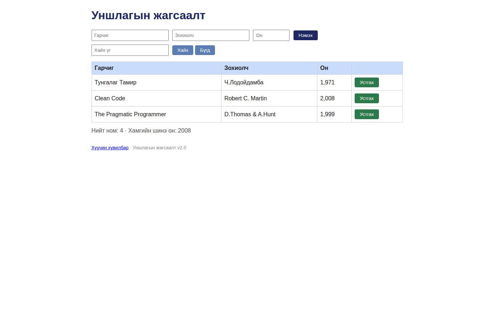

# BUG-03: «Устгах» товч аюултай үйлдлийн улаан өнгөөр ялгарахгүй

Орчин: Уншлагын жагсаалт v2.0, Google Chrome 154.0.8037.92 (headless), Linux 7.0.0-38-generic x86_64, 2026-10-21

Урьдчилсан нөхцөл: node app.js-ийг шинээр асаасан; анхны 3 ном.

## Дахин гаргах алхам

1. Аппыг шинээр асаагаад нүүр хуудсыг нээнэ.
2. Хүснэгтийн «Устгах» товчнуудын өнгийг харна.

Хүлээгдэж байсан: Аюултай устгах үйлдлийн товч улаан өнгөтэй байна.

Бодит үр дүн: Товчнууд ногоон өнгөтэй харагдана (Chrome computed background-color: rgb(44, 122, 75)).

Ноцтой байдал: Cosmetic — товчны ажиллагаа хэвийн ч аюултай үйлдлийг өнгөөр ялгах зааврыг биелүүлэхгүй.

Хавсралт: 

Олдсон аялал: Supermodel (GUI)
