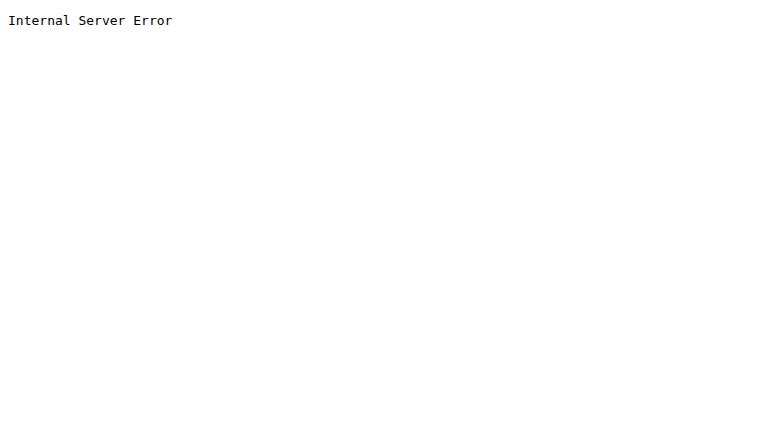

# BUG-05: Нүүрний «Хуучин хувилбар» холбоос HTTP 500 алдаатай хуудас нээнэ

Орчин: Уншлагын жагсаалт v2.0, Google Chrome 154.0.8037.92 (headless), Linux 7.0.0-38-generic x86_64, 2026-10-21

Урьдчилсан нөхцөл: node app.js-ийг шинээр асаасан; анхны 3 ном.

## Дахин гаргах алхам

1. Аппыг шинээр асаагаад http://localhost:3000 нээнэ.
2. Доод хэсгийн «Хуучин хувилбар» холбоосыг дарна.

Хүлээгдэж байсан: Холбоос ажиллаж, хуучин хувилбарын хуудас алдаагүй нээгдэнэ.

Бодит үр дүн: /old зам HTTP 500 Internal Server Error буцааж, дэлгэцэд Internal Server Error гэж гарна.

Ноцтой байдал: Major — хэрэглэгчид харагдаж буй холбоосын зорилтот хуудас ашиглах боломжгүй.

Хавсралт: , [curl -i бүтэн гаралт](../evidence/bug-05-curl.txt)

Олдсон аялал: Supermodel (GUI), Saboteur (HTTP route)
