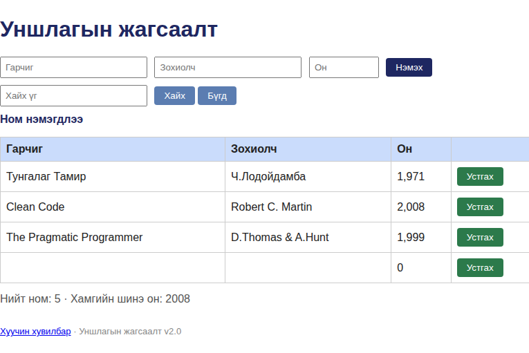
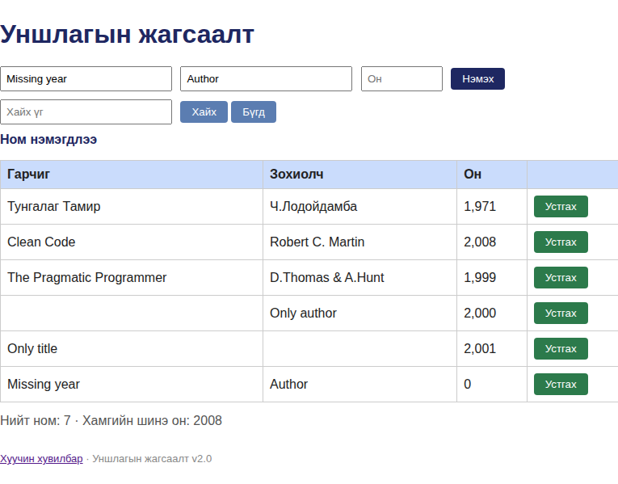

# BUG-06: Гарчиг, зохиолч эсвэл он дутуу номыг алдааны мэдэгдэлгүйгээр нэмдэг

Орчин: Уншлагын жагсаалт v2.0, Google Chrome 154.0.8037.92 (headless), Linux 7.0.0-38-generic x86_64, 2026-10-21

Урьдчилсан нөхцөл: node app.js-ийг шинээр асаасан; анхны 3 ном.

## Дахин гаргах алхам

1. Аппыг шинээр асаагаад http://localhost:3000 нээнэ.
2. Нэмэх формын Гарчиг, Зохиолч, Он талбарыг бүгдийг хоосон үлдээнэ.
3. «Нэмэх» товчийг дарна.

Хүлээгдэж байсан: Ном нэмэгдэхгүй, аль талбар дутсаныг ойлгомжтой мэдэгдэнэ.

Бодит үр дүн: Ном нэмэгдлээ гэсэн амжилтын мэдэгдэл гарч, хоосон гарчиг/зохиолч, 0 онтой мөр нэмэгдэнэ. Талбар тус бүрийг дангаар хоосон үлдээхэд мөн нэмэгдэж, API-д {} явуулахад 201 Created буцсан.

Ноцтой байдал: Major — жагсаалтад хэрэглэх боломжгүй, шаардлагатай өгөгдөлгүй бичлэг үүснэ.

Хавсралт: , , [хоосон талбарын POST](../evidence/bug-06-curl.txt), [дутуу талбарын POST](../evidence/bug-06-missing-curl.txt), [GET дараах жагсаалт](../evidence/bug-06-missing-books-after.txt)

Олдсон аялал: Couch Potato (хоосон оролт), Saboteur (API)
