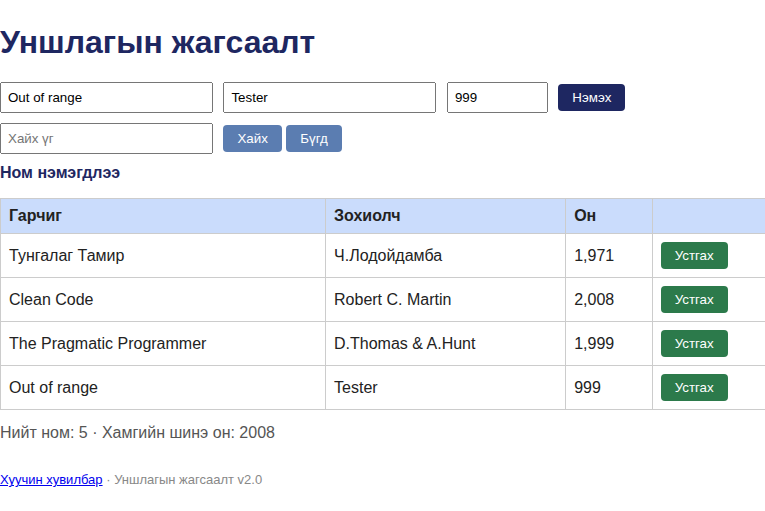
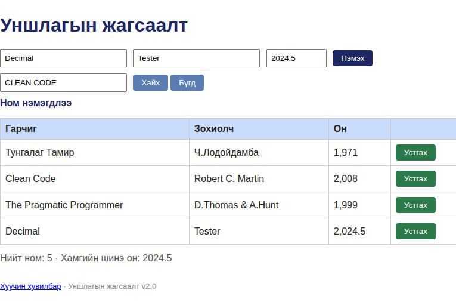

# BUG-07: 1000–2100-ын хүрээнээс гадуурх болон бүхэл бус оныг хүлээн авдаг

Орчин: Уншлагын жагсаалт v2.0, Google Chrome 154.0.8037.92 (headless), curl, Linux 7.0.0-38-generic x86_64, 2026-10-21

Урьдчилсан нөхцөл: node app.js-ийг шинээр асаасан; анхны 3 ном.

## Дахин гаргах алхам

1. Аппыг шинээр асаагаад http://localhost:3000 нээнэ.
2. Гарчиг, зохиолчийг бөглөж, Он талбарт 999 оруулаад нэмнэ.
3. Шинэчилсэн хүснэгтэд нэмэгдсэн мөрийн оныг шалгана.

Хүлээгдэж байсан: Зөвхөн 1000–2100 inclusive хүрээний бүхэл он зөвшөөрөгдөнө; бусад утгад ном нэмэгдэхгүй, ойлгомжтой алдаа гарна.

Бодит үр дүн: 999 амжилттай нэмэгдэж хүснэгтэд харагдана. Ижил баталгаажуулалтгүйгээр 2101, 2024.5, banana утгууд ч API-аар 201 Created болж хадгалагдсан.

Ноцтой байдал: Major — номын он гэсэн үндсэн өгөгдөлд хүрээнээс гадуурх, бүхэл биш, эсвэл тоон бус утгууд орно.

Хавсралт: , , [999](../evidence/bug-07-lower-curl.txt), [2101](../evidence/bug-07-upper-curl.txt), [2024.5](../evidence/bug-07-decimal-curl.txt), [banana](../evidence/bug-07-nonnumeric-curl.txt), [хадгалсан утгууд](../evidence/bug-07-nonnumeric-books-after.txt)

Олдсон аялал: Supermodel (GUI), Saboteur (API)
