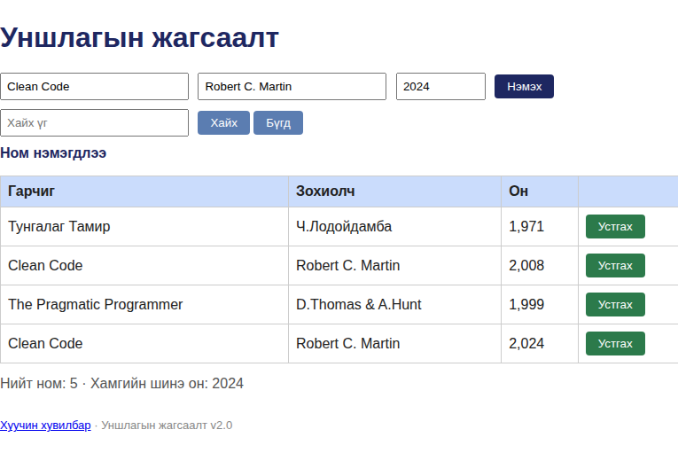

# BUG-08: Ижил гарчиг, зохиолчийн хосыг давхардуулан нэмэхийг зөвшөөрдөг

Орчин: Уншлагын жагсаалт v2.0, Google Chrome 154.0.8037.92, curl, Linux 7.0.0-38-generic x86_64, 2026-10-21

Урьдчилсан нөхцөл: node app.js-ийг шинээр асаасан; эхний жагсаалтад Clean Code / Robert C. Martin байна.

## Дахин гаргах алхам

1. Аппыг шинээр асаана.
2. Гарчигт Clean Code, зохиолчид Robert C. Martin, онд 2024 оруулна.
3. Номыг нэмнэ.

Хүлээгдэж байсан: Ижил гарчиг, зохиолчтой ном давхар нэмэгдэхгүй; давхардлыг тайлбарласан мэдэгдэл гарна.

Бодит үр дүн: Апп Ном нэмэгдлээ гэж мэдээлж, Clean Code / Robert C. Martin хоёр өөр онтойгоор хоёр мөр болов.

Ноцтой байдал: Major — давхардсан бичлэг жагсаалтын үнэн зөв байдлыг алдагдуулна.

Хавсралт: , [API POST](../evidence/bug-08-curl.txt), [GET дараах жагсаалт](../evidence/bug-08-books-after.txt)

Олдсон аялал: Supermodel (GUI), Saboteur (API)
