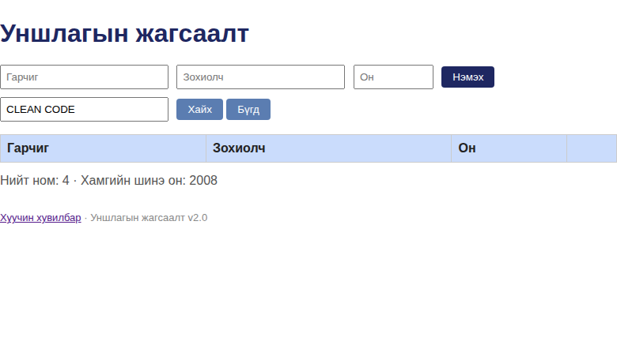
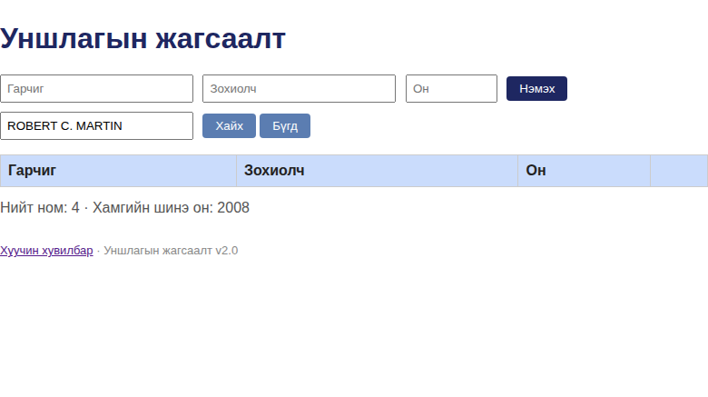

# BUG-09: Хайлт гарчиг, зохиолчийн том/жижиг үсгийг ялгадаг

Орчин: Уншлагын жагсаалт v2.0, Google Chrome 154.0.8037.92 (headless), Linux 7.0.0-38-generic x86_64, 2026-10-21

Урьдчилсан нөхцөл: node app.js-ийг шинээр асаасан; Clean Code / Robert C. Martin эхний жагсаалтад байна.

## Дахин гаргах алхам

1. Аппыг шинээр асаагаад нүүр хуудсыг нээнэ.
2. Хайлтын талбарт CLEAN CODE гэж бичээд «Хайх» дарна.
3. Хайлтын талбарт ROBERT C. MARTIN гэж бичээд дахин «Хайх» дарна.

Хүлээгдэж байсан: Хайлт гарчиг болон зохиогчийн талбараас том/жижиг үсэг үл ялгана; эдгээр хоёр хайлт Clean Code мөрийг олно.

Бодит үр дүн: Хоёр хайлт хоёулаа 0 мөр буцаана. Яг Clean Code болон Robert C. Martin casing-тай хайхад тус бүр 1 мөр олддог; Mongolian title-ийн uppercase хайлт мөн 0 мөр байв.

Ноцтой байдал: Minor — зөвхөн casing өөр хэрэглэгч хайхдаа бодит номоо олохгүй.

Хавсралт: , 

Олдсон аялал: Supermodel (GUI)
