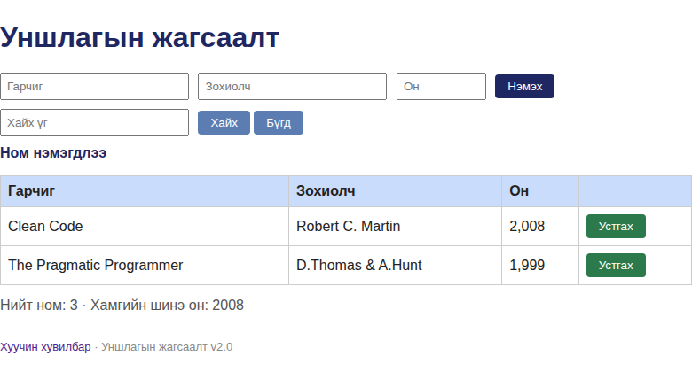

# BUG-10: Ном устгасны дараа амжилтын мэдэгдэл «Ном нэмэгдлээ» гэж буруу гардаг

Орчин: Уншлагын жагсаалт v2.0, Google Chrome 154.0.8037.92 (headless), Linux 7.0.0-38-generic x86_64, 2026-10-21

Урьдчилсан нөхцөл: node app.js-ийг шинээр асаасан; анхны 3 ном; browser-ийг цэвэр хуудсаар нээсэн.

## Дахин гаргах алхам

1. Аппыг шинээр асаагаад http://localhost:3000 нээнэ.
2. Анхны номын мөрөнд байгаа «Устгах» товчийг дарна.
3. Хүснэгтийн мэдэгдлийг харна.

Хүлээгдэж байсан: Мэдэгдэл устгалын үйлдлийг илтгэх (жишээ нь «Ном устгагдлаа») эсвэл өмнөх мессежийг арилгана.

Бодит үр дүн: Мөр устсан боловч Ном нэмэгдлээ гэж гарна; тухайн үйлдлээр ямар ч ном нэмээгүй.

Ноцтой байдал: Minor — өгөгдөл устсан ч хэрэглэгчид хийсэн үйлдлийн эсрэг мэдээлэл өгнө.

Хавсралт: , add→search→delete аяллын нэмэлт зураг [fedex-after-delete.png](../screenshots/fedex-after-delete.png)

Олдсон аялал: Fed-Ex (өгөгдлийн зам), Supermodel (GUI)
