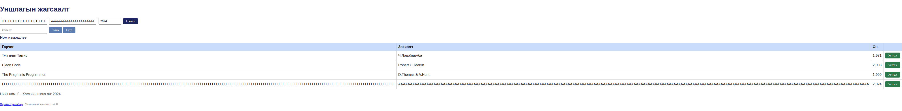

# BUG-11: 200 тэмдэгтийн гарчиг, зохиолч хүснэгтийг дэлгэцийн өргөнөөс хэт тэлдэг

Орчин: Уншлагын жагсаалт v2.0, Google Chrome 154.0.8037.92 (headless), Linux 7.0.0-38-generic x86_64, viewport 780 px, 2026-10-21

Урьдчилсан нөхцөл: node app.js-ийг шинээр асаасан; анхны 3 ном.

## Дахин гаргах алхам

1. Аппыг шинээр асаагаад Chrome viewport-ийг 780 px өргөн болгоно.
2. Гарчигт 200 ширхэг L, зохиолчид 200 ширхэг A, онд 2024 оруулаад нэмнэ.
3. Хүснэгт болон устгах товчны байрлалыг шалгана.

Хүлээгдэж байсан: Урт утгууд хүснэгтийн layout-ийг эвдэхгүй; мөр ба үйлдлийн товч дэлгэцэд ашиглах боломжтой байна.

Бодит үр дүн: Хүснэгт болон page-ийн өргөн 4090 px болж, viewport-оос хэтэрнэ; устгах товчнууд дэлгэцийн гадна очно.

Ноцтой байдал: Major — урт өгөгдөлтэй мөрийн үйлдлийн товчийг харах, ашиглах боломжгүй болгоно.

Хавсралт: 

Олдсон аялал: Supermodel (GUI), Fed-Ex (урт өгөгдлийн зам)
